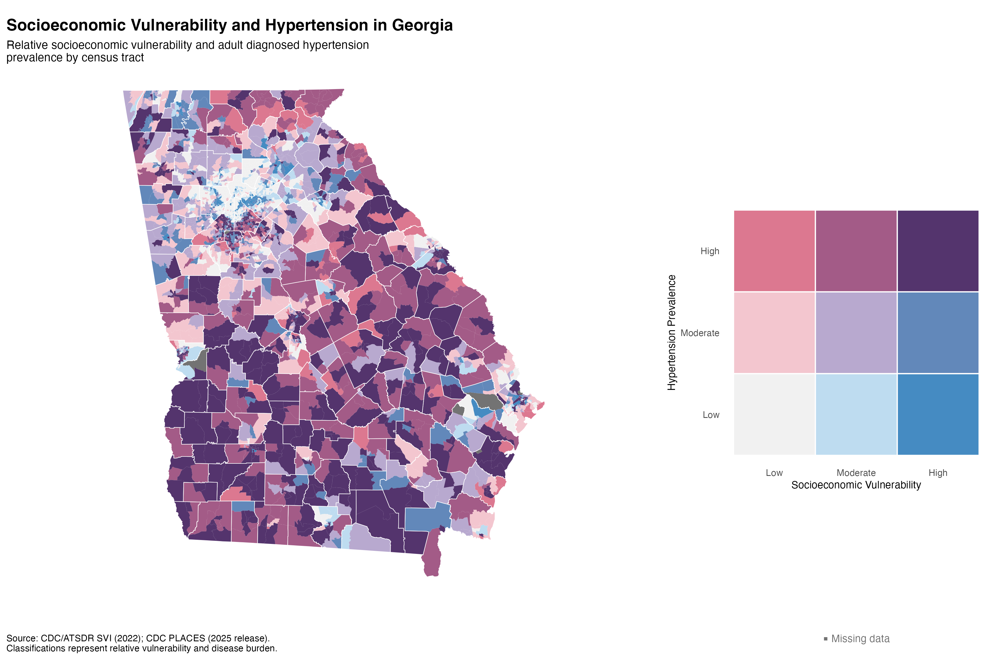
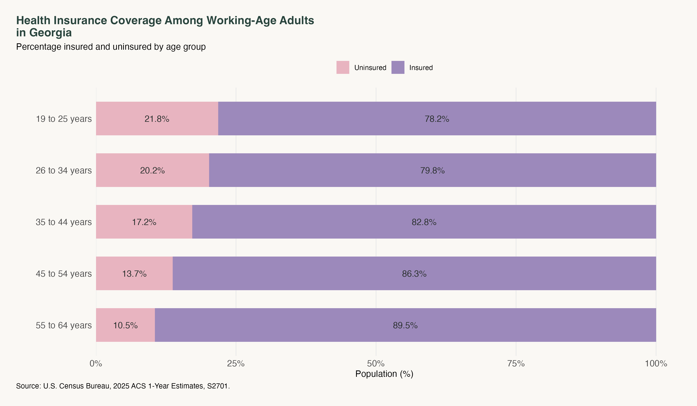

```{=html}
<header class="story-header">

  <a href="index.html" class="story-brand">
    Health in <em>Context.</em>
  </a>

  <span class="story-header-label">
    Georgia · Community Health Profile · 2026
  </span>

</header>

<!-- Mobile-exclusive researcher message -->
<aside class="mobile-researcher-message">

  <h3>A Little Note from the Researcher.</h3>

  <p>Behind every data point is a person, a family, and a community. Thank you for taking a moment to explore the conditions that shape our health. I hope this experience inspires you to look beyond the numbers.</p>

  <p><em>With purpose,</em><br>
  <strong>Kalyn Newton</strong></p>

</aside>
```


<!-- ==================================================
     SECTION 01 — THE PUBLIC HEALTH CONCERN
     ================================================== -->

## Beyond a Blood *Pressure Reading* {#public-health-concern .concern-section}

::: {.editorial-narrative}

Hypertension, commonly known as high blood pressure, is a chronic cardiometabolic condition that often develops without noticeable symptoms. Left untreated or inadequately controlled, it can progressively damage the cardiovascular system and increase the risk of stroke, heart disease, and kidney disease.

While healthy lifestyle practices play an important role in prevention, early detection and long-term management also depend on access to routine medical care, blood pressure monitoring, and appropriate treatment.

:::

::: {.editorial-statistic}

<span class="statistic-number">48.1%</span>

<span class="statistic-description">Nearly half of U.S. adults have hypertension.</span>

<span class="statistic-accent"></span>

Approximately 119.9 million adults nationwide.

<span class="source-note">Source: [Centers for Disease Control and Prevention (2026)](https://www.cdc.gov/high-blood-pressure/data-research/facts-stats/index.html)</span>

:::


<!-- ==================================================
     SECTION 02 — THE SOCIOECONOMIC CONTEXT
     ================================================== -->

## The Conditions That *Shape Health* {#socioeconomic-context .context-section}

::: {.context-artwork}

<div class="context-contours" aria-hidden="true"></div>

<span class="context-star" aria-hidden="true">✳</span>

<p class="editorial-statement">Health extends<br>beyond the<br><em>individual.</em></p>

:::

::: {.editorial-narrative}

The environments in which people live, work, and navigate daily influence their opportunities to maintain good health. Socioeconomic conditions, including income, education, and employment, can shape access to resources necessary for hypertension prevention and management.

Having a healthcare facility nearby does not necessarily mean that its services are accessible. Medical costs, insurance coverage, transportation, and financial circumstances can influence an individual's ability to receive consistent care.

Broader economic pressures and changes in healthcare policy may further intensify these barriers, even within communities traditionally perceived as economically stable.

<span class="source-note">Supporting research: Chaturvedi et al. (2024); Gentili et al. (2016); Blavin & Ramos (2021); Schnake-Mahl & Sommers (2017).</span>

:::


<!-- ==================================================
     SECTION 03 — THE COMMUNITY PROFILE
     ================================================== -->

## Georgia in *Focus* {#georgia-profile .georgia-section}

::: {.georgia-introduction}

Situated within the southeastern United States' Stroke Belt, Georgia provides an important geographic setting for examining cardiovascular health. Across its urban, suburban, and rural communities, differences in socioeconomic conditions and healthcare accessibility present important considerations for hypertension prevention and management.

As Georgia's population and healthcare landscape continue to evolve, this community health profile provides public health practitioners, healthcare leaders, and decision-makers with an overview of socioeconomic vulnerability, hypertension prevalence, and health insurance coverage to inform community health assessments, preventive healthcare planning, and resource allocation.

:::

::: {.georgia-indicators}

::: {.profile-indicator}

<span class="indicator-label">Population</span>

<span class="indicator-value">11.3M</span>

<span class="indicator-description">Residents across Georgia</span>

<span class="source-note">2025 population estimate · [U.S. Census Bureau](https://www.census.gov/quickfacts/GA)</span>

:::

::: {.profile-indicator}

<span class="indicator-label">Hypertension</span>

<span class="indicator-value">35.7%</span>

<span class="indicator-description">Adults with self-reported diagnosed hypertension</span>

<span class="source-note">2023 BRFSS · [America's Health Rankings](https://www.americashealthrankings.org/explore/measures/Hypertension/GA)</span>

:::

:::
::: {.georgia-transition}

Understanding Georgia's overall health profile provides a starting point. Examining individual communities allows us to explore variation that statewide estimates alone may not capture.

:::

<span class="source-note">Supporting research: Gentili et al. (2016); Ostchega et al. (2022); Vernon et al. (2025).</span>


<!-- ==================================================
     SECTION 04 — THE GEOGRAPHIC ANALYSIS
     ================================================== -->

## Exploring Georgia's *Communities* {#geographic-analysis .story-section .analysis-section}

::: {.editorial-narrative}

This bivariate choropleth map illustrates the geographic distribution of socioeconomic vulnerability and hypertension prevalence across Georgia. By comparing these two indicators at the census tract level, we can identify communities where higher or lower levels of socioeconomic vulnerability and hypertension prevalence occur together, as well as areas where these patterns differ.

:::

### Socioeconomic Vulnerability and Hypertension

::: {.map-instructions}

**Explore the map**

Zoom in to explore individual communities, hover over a census tract to preview its classification, and select a tract to view detailed information on socioeconomic vulnerability, hypertension prevalence, and blood pressure medication use.

:::

```{=html}
<iframe
  src="assets/georgia-bivariate-interactive.html"
  title="Interactive bivariate map of socioeconomic vulnerability and hypertension in Georgia"
  width="100%"
  height="650"
  style="border: none;"
  loading="lazy">
</iframe>
```

<span class="source-note">Data sources: CDC/ATSDR Social Vulnerability Index (2022) and CDC PLACES (2025 release).</span>

### Understanding the Map

The bivariate legend combines three levels of socioeconomic vulnerability with three levels of estimated hypertension prevalence, creating nine classifications.

Dark purple identifies census tracts with high levels of both indicators, while lighter gray identifies tracts with low levels of both. Pink and blue shades represent differing combinations of socioeconomic vulnerability and hypertension prevalence. Dark gray indicates missing data.

::: {.callout-note collapse="true" title="View static map and accessible description"}

{fig-alt="Dark purple indicates areas with high levels of both indicators, particularly in central and southern Georgia. Lighter colors are more common throughout metropolitan Atlanta. Pink and blue shades represent different combinations of socioeconomic vulnerability and hypertension prevalence. Dark gray represents areas with missing data."}

Areas of high socioeconomic vulnerability and high hypertension prevalence are particularly visible throughout central and southern Georgia. Lower levels of both indicators are more common across portions of metropolitan Atlanta, although considerable variation exists within the region.

:::

<!-- ==================================================
     SECTION 05 — THE EVIDENCE
     ================================================== -->

## What the Data Reveal {#key-findings .story-section .findings-section}

### Geographic Patterns

Across Georgia, 531 census tracts were classified as having both high socioeconomic vulnerability and high hypertension prevalence. These communities were particularly visible throughout central and southern Georgia.

However, the geographic distribution was not uniform. Some communities with lower socioeconomic vulnerability also experienced relatively high hypertension prevalence, illustrating the complexity of chronic disease burden across different socioeconomic environments.

### Beyond Insurance Coverage

Health insurance coverage provides an important, although incomplete, perspective on healthcare accessibility.

{fig-alt="Horizontal stacked bar chart showing that the percentage of uninsured adults decreases with age, from 21.8% among adults aged 19–25 to 10.5% among adults aged 55–64."}

Among working-age adults in Georgia, younger adults experienced the highest uninsured rates. Approximately one in five adults aged 19–25 lacked health insurance, compared with approximately one in ten adults aged 55–64.

Insurance coverage alone, however, does not guarantee access to preventive healthcare. Out-of-pocket expenses, transportation barriers, and the availability of affordable healthcare services may influence an individual's ability to receive routine care and manage chronic conditions.

### Methods and Considerations

This descriptive community health assessment draws upon three secondary datasets:

- CDC/ATSDR Social Vulnerability Index (2022 data, released in 2024)
- CDC PLACES (2025 release; hypertension estimates based on 2023 BRFSS data)
- U.S. Census Bureau American Community Survey (2025 1-Year Estimates)

Data preparation and analysis were conducted in R. Census tract identifiers were standardized to integrate socioeconomic vulnerability rankings, estimated hypertension prevalence, and blood pressure medication use with geographic boundary data.

Socioeconomic vulnerability, represented by SVI Theme 1 (Socioeconomic Status), and estimated hypertension prevalence were classified into three relative levels and visualized using a bivariate choropleth map. Missing values were retained and distinguished visually. The insurance coverage analysis describes variation in insured and uninsured populations across working-age groups at the state level.

The datasets represent different reference periods, geographic scales, and population groups. Additionally, PLACES provides model-based prevalence estimates. Findings should therefore be interpreted as descriptive geographic and population-level patterns rather than evidence of individual-level associations or causal relationships.

Ethical considerations include protecting individual privacy through the use of publicly available, aggregated data and avoiding the stigmatization of communities. Geographic patterns are presented within the context of broader socioeconomic conditions rather than as judgments about individual health behaviors.

<!-- ==================================================
     SECTION 06 — THE IMPLICATIONS
     ================================================== -->

## From Evidence to Action {#public-health-implications .story-section .implications-section}

### Informing Public Health Practice

Understanding the geographic distribution of hypertension alongside socioeconomic vulnerability provides an opportunity for public health and healthcare leaders to evaluate existing approaches to chronic disease prevention and management.

Communities experiencing overlapping socioeconomic vulnerability and disease burden may benefit from targeted community health assessments, expanded preventive healthcare services, and partnerships with local healthcare organizations.

However, resource allocation decisions should also consider existing healthcare infrastructure, community needs, and barriers that may not be captured through geographic analyses alone.

### Looking Beyond Geographic Accessibility

Community health centers, community-based organizations, and healthcare affordability initiatives represent important opportunities to address gaps in preventive healthcare access.

As healthcare systems navigate rising costs, workforce challenges, and evolving healthcare policies, maintaining accessible and sustainable preventive services remains an important public health priority.

### Refining the Research

This community health profile provides a foundation for further investigation into the relationship between socioeconomic conditions, healthcare accessibility, and chronic disease burden.

Future research may benefit from examining individual-level experiences with healthcare affordability, cost-related barriers to medical care, and the availability and utilization of preventive healthcare services.

Ultimately, understanding where disease burden exists is only one part of the process. Understanding the conditions that shape opportunities for better health is equally important.


<!-- ==================================================
     WEBSITE FOOTER
     ================================================== -->

::: {.story-footer .unnumbered}

::: {.footer-brand}

Health in *Context.*

:::

A Georgia Community Health Profile

::: {.footer-information}

```{=html}
<details>
  <summary>Data Sources</summary>
  <ul>
    <li><a href="https://www.cdc.gov/high-blood-pressure/data-research/facts-stats/index.html">CDC — High Blood Pressure Facts</a></li>
    <li><a href="https://www.atsdr.cdc.gov/place-health/php/svi/index.html">CDC/ATSDR — Social Vulnerability Index (2022)</a></li>
    <li><a href="https://www.cdc.gov/places/">CDC PLACES — 2025 Data Release</a></li>
    <li><a href="https://data.census.gov/">U.S. Census Bureau — 2025 ACS 1-Year Estimates, Table S2701</a></li>
    <li><a href="https://www.census.gov/quickfacts/GA">U.S. Census Bureau — Georgia Population Estimates</a></li>
    <li><a href="https://www.americashealthrankings.org/explore/measures/Hypertension/GA">America's Health Rankings — Georgia Hypertension Prevalence</a></li>
  </ul>
</details>

<details>
  <summary>Supporting Literature</summary>
  <ul>
    <li>Blavin &amp; Ramos (2021). <a href="https://doi.org/10.1377/hlthaff.2020.00502">Medicaid Expansion: Effects on Hospital Finances and Implications for Hospitals Facing COVID-19 Challenges.</a></li>
    <li>Chaturvedi et al. (2024). <a href="https://doi.org/10.1161/HYPERTENSIONAHA.123.21354">Social Determinants of Health and Disparities in Hypertension and Cardiovascular Diseases.</a></li>
    <li>Gentili et al. (2016). <a href="https://doi.org/10.2105/AJPH.2016.303222">Projecting the Impact of Affordable Care Act Provisions on Accessibility and Availability of Primary Care Providers for the Adult Population in Georgia.</a></li>
    <li>Ostchega et al. (2022). Differences in Hypertension Prevalence and Hypertension Control by Urbanization Among Adults in the United States, 2013–2018.</li>
    <li>Schnake-Mahl &amp; Sommers (2017). <a href="https://pubmed.ncbi.nlm.nih.gov/28971923/">Health Care in the Suburbs: An Analysis of Suburban Poverty and Health Care Access.</a></li>
    <li>Vernon et al. (2025). A Comprehensive Mixed-Methods Analysis of Women's Cardiovascular Health Needs in Georgia, United States.</li>
  </ul>
</details>

<details>
  <summary>Accessibility Statement</summary>
  <p>This website was developed with consideration for visual accessibility and inclusive public health communication. Visualizations were evaluated using color vision deficiency simulations and are accompanied by descriptive text, alternative text, or direct data labels.</p>
  <p>A static alternative to the interactive geographic visualization is available for readers who may experience difficulty navigating interactive maps. These features support accessibility but do not constitute formal accessibility certification.</p>
</details>
```

**Developed by Kalyn Newton**

MPH Scholar · Morehouse School of Medicine

Advanced R | Fall 2026

Developed using R, Quarto, Leaflet, and ggplot2 as an academic data visualization project.

© 2026 Kalyn Newton

:::

[Back to the beginning ↑](#public-health-concern)

:::